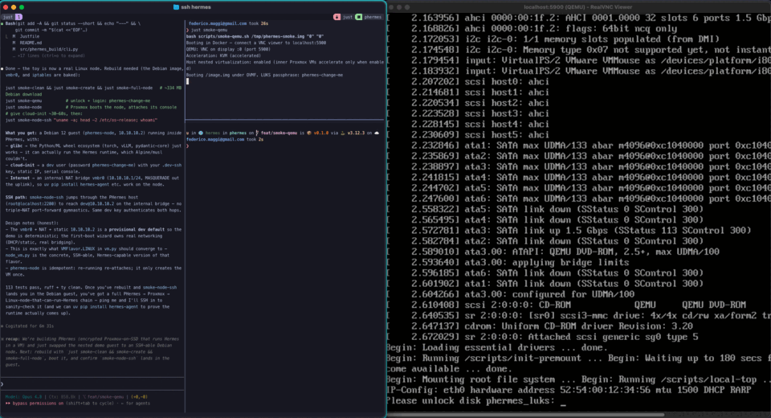

# PHermes

**Personal Hermes** — a fully encrypted, self-hosted, portable AI orchestration appliance.
Plug it into any KVM-capable machine. Boot. Open a browser. Your [Hermes Agent](https://github.com/NousResearch/hermes-agent) environment is ready. Still want to host it in the cloud? Import the disk volume into your favorite cloud provider's stack.



---

### After boot

```
 ____  _   _
|  _ \| | | | ___ _ __ _ __ ___   ___  ___
| |_) | |_| |/ _ \ '__| '_ ` _ \ / _ \/ __|
|  __/|  _  |  __/ |  | | | | | |  __/\__ \
|_|   |_| |_|\___|_|  |_| |_| |_|\___||___/

 ─────────────────────────────────────────────────────
 [ENCRYPTED]  [KVM-ISOLATED]  [SELF-HOSTED]  [PORTABLE]

   VM       macOS 15 Sequoia     ● running
   Hermes   gateway v0.4.1       ● ready
   Storage  LUKS2 / Btrfs / LVM  ● mounted
   Network  192.168.1.42         phermes.local

 → https://phermes.local
 ─────────────────────────────────────────────────────
```

### During build

```
 ╔══════════════════════════════════════════════════════════╗
 ║  phermes-build  ·  Secure AI appliance constructor      ║
 ╠══════════════════════════════════════════════════════════╣
 ║                                                          ║
 ║  ▸ Partitioning SSD ................................ done ║
 ║  ▸ Creating LUKS2 container ........ [████████░░] 80%   ║
 ║  ▸ Installing minimal Debian + phermesd .. pending       ║
 ║  ▸ Configuring PHermes ................. pending          ║
 ║  ▸ Importing VM image .................. pending          ║
 ║                                                          ║
 ╚══════════════════════════════════════════════════════════╝
```

---

## What it is

PHermes packages Hermes Agent inside a QEMU/KVM virtual machine running on a minimal
Debian host managed by `phermesd`. The entire stack lives on a single SSD. No cloud.
No installation on the host. Unplug and take it anywhere.
Still want to host it in the cloud? Import the disk volume into your favorite cloud provider's stack.

**Boot chain:** `EFI → GRUB → minimal Debian → phermesd → Linux guest → Hermes`

The `phermesd` daemon is invisible to end users. PHermes wraps it with a purpose-built
web UI that exposes only what matters: VM console, Hermes dashboard, storage, and system
controls.

## Getting started

You need:

- A **Linux builder** with Python 3.13+, [`uv`](https://docs.astral.sh/uv/), and the
  partitioning toolchain (`cryptsetup`, `lvm2`, `btrfs-progs`, `debootstrap`,
  `dosfstools`, `exfatprogs`). On macOS or Windows, use [Via Docker](#via-docker-linux-host-only).
- A **≥500 GB SSD or USB drive** to write the appliance onto (`phermes-build` WILL erase it).
- An **x86-64 target machine** with KVM (Intel VT-x / AMD-V) that boots from external media.

```bash
# 1. Get the toolchain
git clone https://github.com/phretor/phermes && cd phermes
just install

# 2. Try it against a virtual disk first (no real hardware required)
just smoke-create     # 500 GB sparse image + loop device
just smoke-full       # full build into the loop device
just smoke-qemu serial=1   # boot in QEMU, watch the boot log on the serial console
just smoke-clean

# 3. Build on a real SSD. Production needs a LUKS passphrase you can remember.
lsblk                  # identify the target disk — be careful, it WILL be erased
sudo PHERMES_LUKS_PASSPHRASE='choose-a-strong-passphrase' \
    uv run phermes-build /dev/sdX

# 4. Boot the SSD on the target machine, unlock LUKS, then from your workstation:
ssh root@phermes.local         # appliance announces itself via mDNS
phermesctl status              # see what's running
phermesctl activate linux      # start the bundled Linux guest
phermesctl console linux       # attach to its serial console (Ctrl-] to detach)
```

For a **dev build** with known credentials, SSH key authorized, and a pre-staged guest
image:

```bash
sudo uv run phermes-build /dev/sdX \
    --dev-credentials \
    --dev-ssh-pubkey "$(cat ~/.ssh/id_ed25519.pub)" \
    --import-vm linux=/path/to/linux.qcow2
```

To run a macOS guest you must also supply the Apple OSK — either pre-seeded with
`--dev-apple-osk <64-hex>` (dev builds only) or by writing it to
`/etc/phermes/secrets/apple.osk` (mode 0400) on the appliance after install.

## Security

PHermes is designed for users who treat their AI environment as infrastructure worth protecting.

- **Full-disk encryption.** LUKS2 wraps everything except `/boot` and the EFI partition.
  Data at rest is unreadable without the passphrase. Theft of the drive means nothing.
- **VM isolation.** Hermes runs inside a VM, never on the host. The host is a minimal
  Debian system running only `phermesd` (a small Rust orchestrator) and `sshd` — no
  Proxmox, no web stack, no extra services.
- **Network lockdown.** Management is `phermesctl` over SSH; there is no listening web
  service on the host. Samba is bound to the internal VM bridge, not the LAN. Apple OSK
  and other runtime secrets live in `/etc/phermes/secrets/` (mode 0700, root-only).
- **No binaries distributed.** `phermes-build` debootstraps Debian from official mirrors
  at build time and compiles `phermesd` from the source tree. The tool itself is signed
  and checksummed. No OS images, no Apple/Microsoft binaries, no OpenCore — operators
  supply their own guest images.
- **No shipped credentials.** A production build locks the root account (no console
  login) and refuses to use a hardcoded LUKS key — the passphrase is operator-supplied at
  build time. The Apple OSK is also operator-supplied (drop into
  `/etc/phermes/secrets/apple.osk` post-install). Known test credentials exist solely
  behind an explicit `--dev-credentials` flag and can never appear in a normal build.
- **No mandatory cloud.** LLM API calls are the only optional outbound traffic. Everything
  else runs entirely offline. Local model backends (llama.cpp, vLLM, Ollama) are supported.
- **Snapshot-before-change.** Every VM switch and every update triggers an automatic
  LVM-thin snapshot of the VM disk and a Btrfs snapshot of user data before touching
  anything. One command rolls everything back.

### Threat model

PHermes protects **data at rest** (LUKS2): a lost or stolen device is unreadable without
the passphrase. It deliberately does **not** protect **boot-chain integrity** — `/boot`
and the EFI partition are plaintext and unsigned, and the platform firmware is a trusted,
unverified root of trust. On a *portable* device that boots on arbitrary hardware, the host
firmware and an evil-maid attacker on the boot chain are largely out of scope to defend;
the LUKS passphrase and physical control carry the weight. A future *fixed-install* mode
(Secure Boot + signed UKI + TPM-sealed unlock) is the path to boot integrity for users who
trade portability for tamper-evidence.

Full STRIDE analysis — assets, trust boundaries, per-category threats, mitigations, and
residual risks: **[`docs/threat-model.md`](docs/threat-model.md)**.

## Personalisation

PHermes is not a fixed appliance. It adapts to how you work.

- **Guest OS.** Start with macOS (default), switch to Windows or Linux at any time.
  Your data follows you across switches via a shared Samba mount.
- **LLM backend.** Anthropic, OpenAI, AWS Bedrock, or any local model served via
  llama.cpp, vLLM, LiteLLM, or Ollama. Configured at first boot, changeable anytime.
- **Storage split.** Choose how much of the SSD goes to the persistent data partition
  vs. the exFAT drag-and-drop share. Default: 330 GB / 250 GB on a 1 TB drive.
- **VM specs.** RAM, disk size, and display configuration are set at build time and
  adjustable later via the PHermes UI.
- **Bring your own images.** Pre-stage a VM disk before running `phermes-build` and
  pass it with `--import-vm <flavor>=<path>` (linux, windows, or macos). PHermes
  never distributes OS images.
- **Knowledge base grows with you.** Hermes profiles, tasks, memory, and documents
  live on the encrypted data partition and persist across guest OS switches, updates,
  and even full re-flashes of the system partition.

## Status

Building in public. **Phase 1 (the `phermes-build` CLI) is proven end-to-end** — the
boot chain works on emulated hardware, all the way up to a guest running an AI agent:

```
your machine
└─ QEMU (KVM, nested)
   └─ PHermes — LUKS2-encrypted SSD → GRUB → minimal Debian → phermesd → Linux guest
      └─ Linux guest VM (KVM)
         └─ Hermes Agent
            ● What hostname are you running into?
              → I'm running on hostname: phermes-node
            ● What OS flavor is it?
              → Debian GNU/Linux 12 (bookworm)
            ● Are you on real hardware?
              → No — a KVM virtual machine (vendor: QEMU)
```

What works today: SSD partitioning, LUKS2 full-disk encryption, LVM-thin + Btrfs, a
minimal Debian host running `phermesd` under UEFI with encrypted-root unlock,
and a Linux guest (Debian, glibc) that runs the Hermes runtime — exercised by a
loop-device + QEMU smoke harness (`just smoke-*`) with serial console and dev SSH.

Guest support: Linux (cloud-init seeded in dev builds), Windows BYOI, and macOS BYOI all
provision at install time via `--import-vm <flavor>=<path>`. macOS additionally requires
the Apple OSK at `/etc/phermes/secrets/apple.osk`.

Not yet built: the first-boot wizard, the PHermes web UI, and runtime VM-flavor switching
through the UI. Production builds already ship **no** known passwords or keys.

Design spec: [`docs/superpowers/specs/2026-05-31-phermes-design.md`](docs/superpowers/specs/2026-05-31-phermes-design.md)
Phase 1 plan: [`docs/superpowers/plans/2026-05-31-phase1-phermes-build.md`](docs/superpowers/plans/2026-05-31-phase1-phermes-build.md)

### phermesd (in development)

`phermesd` is a thin Rust/tokio VM orchestrator that replaces Proxmox VE for single-active-VM
operation. Implementation lands in stacked slices:

- **Slice #1 — core orchestrator.** TOML-defined VMs, QEMU/KVM spawn + QMP supervision,
  graceful stop, status, and post-restart re-adopt. Control over a Unix-domain socket via
  the `phermesctl` client. Design:
  [`2026-06-03-phermesd-design.md`](docs/superpowers/specs/2026-06-03-phermesd-design.md).
- **Slice #2 — storage and snapshots.** LVM-thin VM-disk provisioning, local image import,
  QGA-quiesced checkpoints of the VM disk and Btrfs overlay together, auto-snapshot before
  a VM switch, retention prune, thin-pool capacity guard, one-command rollback
  (`phermesctl provision|snapshot|rollback|snapshots`). Design:
  [`2026-06-03-phermesd-storage-design.md`](docs/superpowers/specs/2026-06-03-phermesd-storage-design.md).
- **Slice #6 — host image MVP.** The appliance boots a minimal Debian host running
  phermesd directly — no Proxmox VE. Management is `phermesctl` over SSH; `--no-vm`
  installs the host alone. Design:
  [`2026-06-04-phermesd-host-image-mvp-design.md`](docs/superpowers/specs/2026-06-04-phermesd-host-image-mvp-design.md).
- **Slice #4a — cloud-init for the Linux guest.** Dev builds
  (`--dev-credentials --dev-ssh-pubkey <key>`) ship a NoCloud seed at
  `/var/lib/phermes/seed/linux.iso` attached as a CDROM. First boot configures a `dev`
  user with the operator's SSH key, DHCP on `vmbr0`, and installs `uv`. Production builds
  ship no seed. Design:
  [`2026-06-05-phermesd-cloud-init-design.md`](docs/superpowers/specs/2026-06-05-phermesd-cloud-init-design.md).
- **Slice #4b — console proxy.** `phermesctl console <id>` attaches to the guest's serial
  line (raw terminal, Ctrl-] to detach; Ctrl-C reaches the guest). VNC is doc-only: from a
  workstation, `ssh -L 5900:/run/phermesd/<id>/vnc.sock <appliance>` and point any VNC
  client at `localhost:5900`. Design:
  [`2026-06-10-phermesd-console-proxy-design.md`](docs/superpowers/specs/2026-06-10-phermesd-console-proxy-design.md).
- **Slice #5a — Windows guest (BYOI).** `--import-vm windows=<path>` provisions a Windows
  VM at install time (100 GB LVM-thin LV, VMID=101, 8 GiB RAM, virtio-scsi + virtio-net,
  OVMF). Operator supplies a pre-installed qcow2 with virtio drivers loaded. No
  cloud-init seed; unattend.xml is a later slice. Design:
  [`2026-06-12-phermesd-windows-guest-design.md`](docs/superpowers/specs/2026-06-12-phermesd-windows-guest-design.md).
- **Slice #5b — macOS guest (BYOI).** `--import-vm macos=<path>` provisions a macOS VM
  (120 GB LVM-thin LV, VMID=100, 12 GiB RAM, AHCI + vmxnet3, OVMF + Penryn CPU). Operator
  supplies an OpenCore + macOS qcow2 plus the Apple OSK at
  `/etc/phermes/secrets/apple.osk` (mode 0400). Production builds ship no Apple
  credentials. Design:
  [`2026-06-15-phermesd-macos-guest-design.md`](docs/superpowers/specs/2026-06-15-phermesd-macos-guest-design.md).

## Hardware requirements

**Target machine** (where PHermes runs):
- x86-64 with KVM support (Intel VT-x or AMD-V)
- RAM: ≥16 GB for macOS or Windows VM (32 GB recommended); ≥8 GB for console-only Linux
- ≥500 GB SSD (1 TB recommended; 2 TB+ for large knowledge bases)

**Builder machine** (where `phermes-build` runs):
- **Linux only** — `phermes-build` uses Linux kernel subsystems (cryptsetup, LVM, sfdisk, debootstrap) that have no equivalent on macOS or Windows
- macOS/Windows users: run via Docker (see below) or use a Linux VM

## Distribution

PHermes ships as `phermes-build` — a signed Python CLI that assembles a bootable SSD from
official upstream sources. No OS binaries, no Apple/Microsoft images, and no OpenCore are
bundled — operators supply their own guest images.

### Native (Linux)

Requires Python 3.13+, uv, and the Linux toolchain (`cryptsetup`, `lvm2`, `btrfs-progs`,
`debootstrap`, `dosfstools`, `exfatprogs`):

```bash
# Minimal — first-boot wizard handles VM image acquisition
phermes-build /dev/sdX

# Disk setup only — skip host install (fast iteration / smoke testing)
phermes-build /dev/sdX --skip-os-install

# With pre-staged guest images (BYOI). Repeat --import-vm per flavor.
# linux=<path>: cloud-init seed attaches a CDROM in dev builds (see --dev-credentials).
# windows=<path>: BYOI — operator supplies a pre-installed qcow2 with virtio drivers.
# macos=<path>: BYOI — operator supplies an OpenCore-EFI + macOS qcow2 plus the OSK.
phermes-build /dev/sdX \
  --import-vm linux=/path/to/linux.qcow2 \
  --import-vm windows=/path/to/windows.qcow2 \
  --import-vm macos=/path/to/macos.qcow2 \
  --dev-credentials --dev-apple-osk <64-hex-char-string>
# Production: drop the Apple OSK into /etc/phermes/secrets/apple.osk (mode 0400)
# on the appliance post-install instead of using --dev-apple-osk.

# Custom share partition (size in GB; 0 disables)
phermes-build /dev/sdX --share-size 500 --share-encrypted
```

### Via Docker (Linux host only)

Bundles the full toolchain — no local dependencies required beyond Docker:

```bash
# Pre-load the kernel targets the container can't modprobe itself
sudo modprobe dm-thin-pool dm-crypt btrfs vfat

sudo docker run --rm --privileged \
  -v /dev:/dev \
  ghcr.io/phretor/phermes-build \
  /dev/sdX
```

`-v /dev:/dev` shares the host device tree so the partition nodes created during the
build are visible inside the container. The container shares the host kernel but cannot
load modules itself, so the device-mapper and filesystem targets must be present on the
host first. `just docker-run /dev/sdX` wraps both steps.

> **Note:** Docker device sharing only works on Linux hosts. Docker Desktop on macOS
> and Windows does not surface host block devices into containers.

> **macOS note:** macOS VMs may only be run on Apple hardware under the macOS EULA.
> PHermes does not distribute macOS images; users supply their own installer.

## Development

[`just`](https://github.com/casey/just) drives every common task (`just --list` for the
full set). Unit tests need no root and run on any OS; everything else is Linux-only.

```bash
just install          # uv sync
just test             # unit tests (no root, any OS)
just check            # lint + typecheck + unit tests (pre-commit gate)
just docker-build     # build the phermes-build image
```

### Smoke testing on a virtual disk

The build runs end-to-end against a sparse file attached as a loop device — no real
hardware required. The recipes manage the loop device, kernel modules, and teardown:

```bash
just smoke-create     # 500G sparse image at /tmp/phermes-smoke.img + loop device
just smoke-run        # disk setup only (partition/LUKS/LVM/Btrfs), ~seconds
just smoke-full       # full build including minimal Debian + phermesd install
just smoke-inspect    # lsblk + LVM + Btrfs state
just smoke-verify     # mount every partition and assert expected content
just smoke-qemu       # boot the image in QEMU under OVMF (UEFI, no KVM needed)
just smoke-shell      # interactive shell in the build container
just smoke-clean      # tear down and delete the image
```

### Running a Linux node guest (nested)

`just smoke-full-node` bundles a Debian cloud image into the build (dev only — production
never ships an OS image). After booting the PHermes host, `phermesd` starts it as a
nested KVM guest, configured via the slice #4a cloud-init seed (a `dev` user with your
`.dev-ssh` key, DHCP on the internal bridge). Then:

```bash
just smoke-node          # boot the node, attach its serial console
just smoke-node-ssh      # SSH in as dev@10.10.10.2 (jumps through the PHermes host)
```

glibc (Debian, not Alpine/musl) so the Python/ML wheel ecosystem works — i.e. it can
actually run the Hermes runtime. Requires host nested virt (`kvm_intel`/`kvm_amd
nested=1`), which `smoke-qemu` exposes via `-cpu host`.

`smoke-qemu` boots the built disk in QEMU through a small dedicated container
(`Dockerfile.qemu`) so no host QEMU/OVMF install is needed — it serves the display over
VNC on `localhost:5900`. Pass `native=1` to run QEMU directly on the host instead (opens
a graphical window when `$DISPLAY` is set), or `serial=1` to stream the boot to your
terminal (`just smoke-qemu serial=1`) — the guest is built with a serial console, so you
see the full boot log and can type the LUKS passphrase there. Exit serial mode with
`Ctrl-A X`.

It uses **KVM acceleration when `/dev/kvm` is available** and falls back to TCG emulation
automatically when it isn't — so KVM is never required, just used when present. If the
host has nested virtualization enabled (`kvm_intel`/`kvm_amd nested=1`) and `-cpu host`
exposes `vmx`/`svm`, the inner phermesd guest can accelerate too; otherwise only the
PHermes host itself is accelerated.

Unlike the build, `smoke-qemu` needs **no root**: QEMU runs as your user (native) or
unprivileged in the container (Docker), reading the image read-only via `-snapshot`. The
only privileged dependency is Docker-daemon access in Docker mode — and it skips `sudo`
when you're in the `docker` group.

`smoke-run` / `smoke-full` use Docker by default; pass `native=1` to run `phermes-build`
directly. The active loop device is recorded in `.smoke`. Always `smoke-clean` before a
fresh `smoke-create`. `smoke-verify` exits non-zero if any partition check fails, so it
doubles as a CI-style gate.

## License

PHermes's own code is licensed under the **GNU Affero General Public License v3.0**
(see [`LICENSE`](LICENSE)). Copyright © 2026 Federico Maggi.

**Commercial licensing.** As the copyright holder, the author can grant commercial licenses
for use without AGPL obligations — e.g. embedding PHermes in a proprietary hardware
appliance or hosted offering. Contact <fede@maggi.cc>.

Components fetched or used at build/run time keep their own licenses:

- Debian (debootstrapped at build time), the Linux kernel, and other packages: their
  respective licenses
- Hermes Agent: MIT
- Rust crates used by `phermesd`: their respective licenses (mostly MIT/Apache-2.0)
